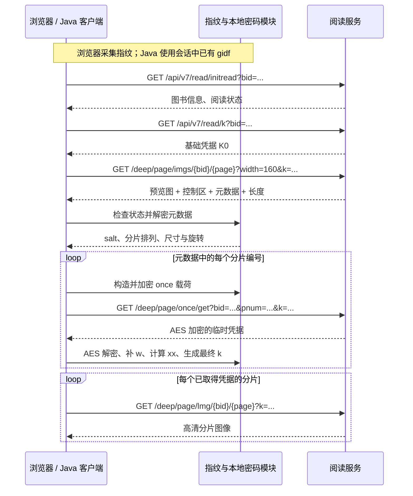

# 某某学堂阅读器逆向分析与 OkHttp 客户端完整报告  感谢Chatgpt 

> 分析日期：2026-10-27  
> 对象：用户提供的网页阅读器 8.0.422、三份 HAR、Java 客户端及运行记录  
> 核心脚本：`/deep/static/pdf/8.0.422/js/pdf.bdc53b74.js`  
> 本文不包含真实 Cookie、完整指纹、基础阅读凭据、临时凭据或可直接复用的图片 k。

## 1. 结论与阅读路线

这套阅读器的高清图请求不是“书号 + 页码 + 一个固定 key”。它是一条依赖上游响应的请求链：

```text
浏览器采集环境特征 → visitorId → gidf Cookie / WASM 指纹状态
                                      ↓
初始化阅读信息 → 基础凭据 K0 → 小图及尾部元数据
                                      ↓
                   分片编号 + 本页校验串 salt
                                      ↓
                  为每个分片申请临时凭据
                                      ↓
                 AES 解密 → 补 w → 计算 xx
                                      ↓
              ChaCha20 加密最终载荷 → lmg 高清分片
```

本项目已经确认以下事实：

1. **三处名为 k 的 URL 参数含义不同。** 小图 k 是基础凭据 JSON 的 Base64；`once/get.k` 是申请临时凭据的加密载荷；`lmg.k` 是带有服务端临时凭据和本页校验结果的加密载荷。
2. **浏览器指纹参与实际加密。** 指纹库为内嵌的 FingerprintJS 4.6.2，`visitorId` 写入 `gidf`，并参与 ChaCha20 的 32 字节 key 和 12 字节 nonce 派生。
3. **指纹摘要与分片校验摘要不是同一个算法。** `visitorId` 使用 MurmurHash3 x64 128；临时对象中的 `xx` 使用 MD5。
4. **真实抓包已完成上游重算。** `1111.har` 中 42 次成功的 `once/get`、42 次 `lmg`，原始 URL 中的 k 都能逐字符重建一致。不是只做解密再加密的自洽检查。
5. **Java 客户端已经实现对应协议。** 包含离线 HAR 核对、在线单页请求、分阶段停止、Cookie 更新、二进制元数据解析，以及分片和过程记录保存。
6. **第 100 页失败发生在预览元数据阶段。** `2222222.har` 的 HTTP 状态是 200，但响应尾部业务状态为 40109，元数据是失败标记。此时尚未进入临时凭据和高清请求。
7. **同一配置的第 1 页在线预览对照成功。** 因而目前证据更指向第 100 页的阅读权限限制，而非基础 k 生成错误；但没有取得服务端错误码文档，不能把 40109 在所有情形下都定义为“超过试读页数”。

想了解整条协议，读第 3～7 节；想重点理解浏览器指纹，读第 8 节；想使用或修改客户端，读第 10～12 节；第 100 页报错见第 13 节。

## 2. 材料、版本与证据边界

### 2.1 输入材料

| 材料 | 内容 | 能证明什么 |
|---|---|---|
| `Untitled.har` | 27 条记录，均为 JavaScript 资源 | 提供阅读器源码、混淆逻辑和内嵌 WASM；不能单独证明业务请求实际成功 |
| `1111.har` | 247 条记录，含完整阅读链路 | 验证基础凭据、小图、临时凭据、最终图片 k 的实际对应关系 |
| `2222222.har` | Java 客户端访问第 100 页的 3 条记录 | 定位当前失败发生在哪个步骤，并检查本次基础 k |
| `1122/manifest.json`、`trace.json` | Java 运行输出 | 交叉核对客户端执行阶段、HTTP 状态及停止原因 |
| Java 项目、测试与发行 JAR | 客户端实现 | 核对代码行为、独立向量、本机 HTTP 测试与最终 JAR 离线结果 |
| 同配置第 1 页在线对照 | 执行至 preview | 证明这份配置在对照时能完成初始化、基础凭据和第 1 页元数据解析 |

原始文件位置：

```text
/Users/fuchunming/Downloads/Untitled.har
/Users/fuchunming/Downloads/1111.har
/Users/fuchunming/Desktop/2222222.har
/Users/fuchunming/Desktop/okhttp-reader-explorer/1122/manifest.json
/Users/fuchunming/Desktop/okhttp-reader-explorer/1122/trace.json
```

用户明确说明：`1111.har` 中第 120 页的那条请求，是最初在 Charles 中修改的测试。本文把它作为“人工改参记录”，不会把它当成浏览器自然行为或权限规则的依据。

### 2.2 证据如何分级

- **源码确认**：在捕获的 JS/WASM 中找到明确实现。能说明该版本客户端怎么做，不能直接证明服务端怎么校验。
- **抓包确认**：实际请求和响应满足该关系，并能从上游数据独立重算。
- **在线确认**：当前 JAR 使用具体会话实际发出请求，并取得对应结果。
- **推断**：多项事实指向某个原因，但缺少服务端实现或足够对照，不写成定论。

本报告的协议结论对应捕获版本。没有服务器源码，也没有声称覆盖 App SDK、机构单点登录、所有嵌入页面、验证码或未来版本。

### 2.3 实际图书上下文

书号为 `3258702`，书名为《数字媒体设计（第2版）（微课版）》。初始化响应显示总页数 174、`canread=0`、`canreadpages=30`、`ismultivolumed=0`、`pdfepub=0`。原始完整抓包的登录检查返回 `3001 / 请先登录`。

这些是实际返回值，不应把 `isfull` 等字段名直接解释为用户拥有全书权限。最终是否发放某页元数据、临时凭据和图片，仍由后续接口决定。

## 3. 先分清所有“key”

| 名称 | 来源 | 类型与用途 |
|---|---|---|
| `K0` | `/api/v7/read/k` 响应 `data` | 本文给基础阅读凭据对象起的名字；由服务器生成 |
| `state.aesK` | `JSON.stringify(K0)` | 前端保存的 JSON 字符串；变量名容易误导，它并非直接可用的 AES 原始 key |
| `imgs.k` | Base64 编码上述 JSON | 小图请求参数 |
| ChaCha20 key / nonce | 从指纹 UTF-8 字节派生 | 加解密请求载荷及小图元数据 |
| `once/get.k` | ChaCha20 加密申请载荷后编码 | 每个分片申请临时凭据时使用 |
| AES key | `K0.i` 前 16 个字符补齐后转 UTF-8 | 解密 `once/get` 响应 |
| `T` | AES 解密后的临时对象 | 服务端发给某次分片申请的凭据，不能用 K0 直接替代 |
| `salt` | 小图尾部解密结果 | 本文对本页校验串的命名；观察到长度 36，不据此断言其随机性或密码学标准含义 |
| `T.xx` | 临时字段值与 salt 拼接后 MD5 | 最终载荷内的校验字段 |
| `lmg.k` | ChaCha20 加密最终载荷后编码 | 请求高清分片时使用 |

`requestId`、`accessToken`、`frameUrl` 是会话/入口上下文，不是上述任意一种 key 的别名。

## 4. 整体时序与初始化

### 4.1 时序图



图中省略了目录、阅读位置、登录检查、笔记等旁路请求。它们出现在网页里，并不意味着它们都是生成图片 k 的必需输入。

### 4.2 浏览器启动

捕获的脚本先加载指纹采集器，调用 `get()` 得到结果，再把 `visitorId` 写入 Cookie 并传给 WASM。WASM 就绪后经 `window.computeVH` 交给阅读器和内容组件，触发 `initPdfRead`。

阅读入口解析书号、页码、分册、`access_token` 等。普通网页随后调用 `read/initread` 和 `read/k`。

源码还存在 `socketReport` 分支：如果相关初始化信息带有 token，会使用 token 和当前会话标识进行上报。**两份相关实际初始化响应没有该 token，因此本次正常抓包和第 100 页故障不能归因于漏掉了这一分支。** 其他入口是否需要它，应看实际返回，而不是一律忽略。

### 4.3 接口参数概览

| 接口 | 主要参数 | 分册参数 |
|---|---|---|
| `/api/v7/read/initread` | `bid`，入口存在时带 `access_token` | `num` |
| `/api/v7/read/k` | `bid`，入口存在时带 `access_token` | `volume_no` |
| `/deep/page/imgs/{bid}/{page}` | `width=160`、`k`；请求头 `RequestID` | `v` |
| `/deep/page/once/get` | `bid`、`pnum`、`k` | 以捕获的封装逻辑为准 |
| `/deep/page/lmg/{bid}/{page}` | `k` | `v` |

这些字段在不同接口中并不统一。Java 客户端按当前捕获逻辑分别构造，不能简单把同一组 query 复制到所有请求。

### 4.4 K0 的获取与刷新

成功的 `read/k` 响应使用业务 `code=0`，`data` 为对象。当前实际字段插入顺序为：

```text
u, i, t, b, n, s, d, x
```

本次这些字段都是字符串。客户端保存其紧凑 JSON，字段顺序会影响后续字节级加密结果。

源码有 540000 毫秒，即 9 分钟的定时更新，以及特定错误下的刷新和重试分支。这能证明前端的刷新策略，**不能证明服务端凭据有效期恰好为 9 分钟**。Java 探索客户端目前没有复制全部自动刷新策略。

## 5. 小图：图片数据与协议控制数据的结合

### 5.1 小图 k

浏览器的实际操作是：

```text
baseJson = JSON.stringify(K0)
smallKey = btoa(baseJson)
```

`btoa` 是单字节字符串到 Base64 的编码，本次 K0 内容满足这个条件。它没有对小图 k 再做 ChaCha20 加密。Java 实现显式检查字符范围，避免在遇到未验证字符集时默默生成不同字节。

`1111.har` 的全部 9 条小图请求，解码 k 后均与当次 `read/k` 对象的紧凑 JSON 一致；第 100 页故障抓包也通过了这一检查。

### 5.2 二进制布局

设完整响应字节数组长度为 `N`，最后 4 字节按大端读取得到元数据长度 `L`：

```text
偏移 0                                       N-10-L
┌──────────────────────────────────────────────┐
│ 前端用作图像的数据区                         │
├──────────────────────────────────────────────┤
│ 6 字节控制区：前 2 字节为大端业务状态         │
├──────────────────────────────────────────────┤  N-4-L
│ L 字节元数据文本                             │
├──────────────────────────────────────────────┤  N-4
│ 4 字节大端 L                                 │
└──────────────────────────────────────────────┘  N
```

对应公式：

```text
L             = uint32_be(body[N-4 : N])
metadataStart = N - 4 - L
status        = uint16_be(body[metadataStart-6 : metadataStart-4])
metadata      = body[metadataStart : N-4]
imagePayload  = body[0 : metadataStart-6]
```

控制区另外 4 字节的完整语义没有在本项目中确定，不赋予未经验证的含义。

这里的 `imagePayload` 是前端切出的图像载荷，不保证恰好终止在图像容器声明的边界。第 100 页响应中，真正 RIFF/WebP 容器长 4146 字节，而按上述布局切出的图像载荷区域长 4215 字节。这一差异应保留，不能把所有前缀字节都称为严格的 WebP 容器内容。

### 5.3 元数据成功与失败

原脚本会读取 `gidf` 与 WASM 状态的一致性；然后处理失败标记或正常元数据。

- 元数据为 `0000000000`：进入失败分支，读取控制区状态，不能进入正常高清分片流程。
- 元数据已经含 `[` 与 `]`：源码支持直接解析明文形式。
- 否则：Base64 解码，再用指纹派生的 ChaCha20 解密。

小图元数据解密的 counter 来自 DOM 页面 index。捕获的实际页面中，该 index 与页码一致，所以 Java 使用页码；特殊排版或其他阅读器若改变这个映射，需要重新核对。

Java 还显式检查响应长度、元数据长度范围、状态非零、分片编号是否为完整排列，避免把异常二进制继续当作成功数据处理。

### 5.4 元数据包含什么

第 1 页第一次正常请求解析出：

```text
salt：36 字符，本报告省略实际值
分片排列：[2, 1, 4, 3, 0, 5]
尺寸/旋转：334-335-1439-90-1439-2005
```

按 `getJK` 的实际使用方式，六个尺寸项分别对应：

| 位置 | 源码用途 |
|---:|---|
| 0 | 普通分片宽度 |
| 1 | 最后一个编号分片的宽度 |
| 2 | 显示高度 `clientHeight` |
| 3 | 旋转角度输入；应用时使用其相反数生成矩阵 |
| 4 | 页面原始宽度 |
| 5 | 页面原始高度 |

对于编号 `z`，横向位置使用 `普通分片宽 × z`；当 `z == 分片数-1` 时采用末片宽。请求次序中的第几个，与分片在页面中的位置，不是同一概念。

当前七个正常页面各有 6 片，这是样本事实。协议实现应从数组读取片数，不应把 6 当成所有书的固定值。

### 5.5 为什么改 width 没有得到高清

第 1 页抓到三个 width 值：160、1600、500。三次解出的图像载荷均为 4731 字节，实际显示尺寸均为 160×223，图像载荷的 SHA-256 相同；尾部元数据则不同。

这说明本次提高 width 没有提高预览清晰度。高清内容实际通过 `lmg` 分片获取。不能把整个响应哈希变化误判为图片变清晰，也不能从这三个样本推导服务端在所有情形下都忽略 width。

另一个已纠正的细节：源码构造 data URL 时写 `image/jpeg`，但实际预览和高清分片的文件格式是 WebP。判断格式应看响应与文件头。

## 6. 临时凭据：once/get、AES 和 xx

### 6.1 构造每个分片的申请载荷

下面用第 1 页、分片 2 说明结构。凭据用占位文字表示，不是可执行请求值：

```json
{
  "p": "1",
  "t": 1793081947000,
  "b": 3258702,
  "w": 1000,
  "k": "<K0 的紧凑 JSON 字符串>",
  "zn": 2
}
```

关键细节：

- `p` 是字符串；`b`、`t`、外层 `w`、此处 `zn` 是数字。
- `k` 是 JSON 字符串，不是直接嵌套一个 JSON 对象。
- 插入顺序为 `p,t,b,w,k,zn`。
- `t` 是毫秒单位，但原逻辑按整秒生成，末三位为 000。Java 使用 `floor(currentMillis/1000)*1000` 对应。
- 外层 `w=1000` 是源码中的载荷值，尚未确定后端语义，不能仅凭名称把它等同于图片像素宽。

载荷紧凑序列化为 UTF-8 后，使用指纹派生的 ChaCha20、counter=1 加密，再 Base64。

### 6.2 once/get 有两层 URL 编码

实际处理顺序：

```text
JSON → UTF-8 → ChaCha20 → Base64
     → encodeURIComponent
     → Axios params 再序列化
```

因此原始 HAR URL 的 `once/get.k` 带两层百分号编码。举例说明编码层次，以下不是实际密文：

```text
Base64 片段：         ab+c/==
第一次编码：          ab%2Bc%2F%3D%3D
再次作为参数编码：    ab%252Bc%252F%253D%253D
```

在 Java 中，先执行等价 `encodeURIComponent`，再使用 OkHttp 的 `addQueryParameter`，让查询串序列化完成第二层。

不能用“请求能被解析”代替“参数编码等价”的验证；本项目对 42 条请求比较的是 HAR 中原始 URL 参数。

### 6.3 服务端临时凭据的 AES 解密

`once/get` 成功时返回 `code=0`，`data` 为密文字符串。AES key 的源码逻辑是：

```javascript
keyText = K0.i.substring(0, 16).padEnd(16, "0");
aesKey = UTF8(keyText);
```

使用 AES-ECB、PKCS#7 填充，没有 CBC IV。Java 对 AES 使用 `AES/ECB/PKCS5Padding`，其实际块填充在这里与 PKCS#7 对应。实现要求最终 UTF-8 key 长度为 16 字节。

CryptoJS 的 OpenSSL 格式可能带 `Salted__` 与 8 字节头部 salt，Java 解析器有相应兼容处理；这里依然使用显式原始 key，不因识别到格式头就改成口令派生模式。

本次 42 份临时响应均能解密为对象，字段顺序为：

```text
b, d, i, n, s, t, u, x, zn
```

这些字段在样本中都是字符串，尤其 `zn` 已经是服务端返回的编码字符串，不能重新替换成申请时的数字分片编号。第一份临时对象与 K0 同名的字段值都发生变化，因此临时对象并非 K0 加一个编号。

### 6.4 frameUrl 如何进入校验

解密得到 `T` 后，前端先补充：

```javascript
T.w = cT() || "";
```

普通顶层阅读页面在这次抓包中的值为空字符串。源码有针对特定 `wqbook/wqshuju` 嵌入环境的分支，使用当前阅读文档 URL。这个值不是一概填写浏览器外层页面地址，也不是 HTTP Referer 的直接别名。

Java 通过 `session.frameUrl` 提供该值。目前样本使用空字符串，特殊入口需以实际运行分支和抓包为准。

### 6.5 xx 的精确计算

按源码顺序，逻辑等价于：

```javascript
T.w = frameUrl || "";
const names = Object.keys(T).sort();
if (!T.zn) delete T.zn;

let joined = "";
for (const name of names) {
  joined += T[name] + salt;
}
T.xx = MD5_UTF8_HEX(joined);
```

这里最容易写错的地方有四个：

1. 排序的是属性名，拼接的是属性值。
2. 每一个属性值后面都追加 salt，并非只在末尾追加一次。
3. `w` 在排序前加入，所以空字符串 w 也会带来一次 salt。
4. 属性名列表先取出，随后才删除假值 `zn`。如果发生删除，列表仍保留该名称，读取缺失值会得到 JavaScript 的 `undefined`。当前正常样本的 zn 为非空编码字符串，没有触发该边界。

这不是 `MD5(JSON.stringify(T))`，也不是常见的 `key=value&key=value` 签名串。没有在这里发现 HMAC 或私钥签名操作。

## 7. 最终高清 k 与分片下载

### 7.1 最终载荷

将补完 w、xx 的 T 再次转为紧凑 JSON 字符串，放入外层：

```json
{
  "p": "1",
  "t": 1793081947000,
  "b": 3258702,
  "w": 1000,
  "k": "<包含服务端临时字段、w、xx 的 T 的 JSON 字符串>"
}
```

仍是 ChaCha20、counter=1，再 Base64。`getRk` 是本地计算函数名，不是又一个网络接口。

### 7.2 lmg 只有一层 URL 编码

最终 URL 在前端直接拼接：

```text
/deep/page/lmg/{bid}/{page}?k=encodeURIComponent(Base64密文)
```

因此本次 `lmg.k` 只有一层百分号编码。Java 使用 `addEncodedQueryParameter` 放入已经编码的值，避免多编码一层。

相同书号、相同页码的六个高清请求，路径可能完全相同；分片身份和各自临时凭据位于不同的 k 内部。

### 7.3 浏览器怎么请求、客户端怎么保存

真实第 1 页中，浏览器先按 `[2,1,4,3,0,5]` 依次取得临时凭据，随后几乎同时加载六张高清图。Java 为方便观察，也先取得全部临时凭据，但随后按顺序下载图片。

Java 文件名按真实分片编号保存，例如 `fragment-002.webp`，不是单纯按“第二个完成的响应”命名。输出的 manifest 保留原始分片顺序和尺寸/旋转参数。

当前客户端交付的是分片图像，不自动拼接整页，也不生成整本 PDF。拼接必须处理编号位置、末片宽、旋转和缩放，不能直接按网络完成顺序横向拼图。

## 8. 浏览器指纹专题：从采集到发挥作用

### 8.1 本项目的指纹到底是什么

捕获脚本中可以找到 `version:"4.6.2"`、组件采集器、`visitorId` getter、组件规范化函数及 128 位哈希实现。它们对应 FingerprintJS 4.6.2 的本地浏览器指纹逻辑。官方同版本的 [agent.ts](https://github.com/fingerprintjs/fingerprintjs/blob/v4.6.2/src/agent.ts) 与 [hashing.ts](https://github.com/fingerprintjs/fingerprintjs/blob/v4.6.2/src/utils/hashing.ts) 可用于交叉核对算法名称和摘要入口。

本节的站点行为、具体采集分支、Cookie 和 WASM 连接方式，均以 HAR 内嵌脚本为依据，不能直接套用其他 Fingerprint 商业产品的服务端识别机制。

指纹可以理解为：**把当前浏览器能观察到的一组环境特征，变成一个方便比较的摘要字符串。**

它不是随机生成的 UUID，也不是仅对 User-Agent 做哈希，更不是操作系统提供的永久设备身份证。在该实现中，输出为 32 个十六进制字符，表示 128 位摘要；格式像 MD5，不代表算法就是 MD5。

### 8.2 采集从哪里发生

网页 JavaScript 在用户的浏览器中执行。它调用 `navigator`、`screen`、Canvas、WebGL、音频计算、字体布局、CSS 媒体查询等浏览器 API，读取或测量结果。

这一过程主要在本地发生。读到“支持 localStorage”也不等于遍历用户的所有存储内容；检测音频运算也不等于录音；测量字体不等于拿到了电脑全部文件。

当前脚本包含以下采集项。表中列的是实现包含的能力，不表示它们在用户这台 Safari 上都返回了完整数据：代码会根据浏览器、版本和 API 可用性跳过某些项或返回特殊状态。

| 类别 | 源码组件名 | 获取方式与含义 |
|---|---|---|
| 字体与排版 | `fonts`、`fontPreferences` | 创建隐藏布局，比较字体和默认字体配置下的文字尺寸 |
| 二维绘图 | `canvas` | 绘制文字、图形、混色和路径，读取结果及稳定性 |
| 音频计算 | `audio`、`audioBaseLatency` | 离线合成声音并计算样本特征；在支持的环境读取音频基础延迟 |
| WebGL | `webGlBasics`、`webGlExtensions` | 查询版本、渲染器、可用扩展、参数和着色器精度 |
| 语言与时间 | `languages`、`timezone`、`dateTimeLocale` | 读取语言列表、时区、日期时间格式地区 |
| 显示环境 | `colorDepth`、`screenResolution`、`screenFrame` | 色深、屏幕尺寸及可用区域；部分值会取整或跳过 |
| 平台与能力 | `osCpu`、`deviceMemory`、`hardwareConcurrency`、`cpuClass`、`platform` | 浏览器暴露的平台、内存和并发能力等，可能不支持或受限 |
| 浮点行为 | `math`、`architecture` | 固定数学运算结果，以及特定浮点字节表现 |
| 浏览器环境 | `vendor`、`vendorFlavors`、`plugins` | 厂商字段、特定全局对象、插件及 MIME 类型信息 |
| 触摸 | `touchSupport` | 最大触点、触摸事件和属性是否可用 |
| 存储能力 | `sessionStorage`、`localStorage`、`indexedDB`、`openDatabase` | 检查 API/存储能力，不是读取所有存储记录 |
| Cookie 能力 | `cookiesEnabled` | 写入一个测试 Cookie、读取验证后删除 |
| 内容过滤表现 | `domBlockers` | 用测试元素及选择器观察 DOM 显示行为，推测过滤规则影响 |
| 颜色与偏好 | `colorGamut`、`invertedColors`、`forcedColors`、`monochrome`、`contrast`、`hdr` | CSS 媒体查询反馈的显示能力和偏好 |
| 动效与透明度偏好 | `reducedMotion`、`reducedTransparency` | 媒体查询返回的相关偏好状态 |
| 其他浏览器功能 | `pdfViewerEnabled`、`applePay`、`privateClickMeasurement` | 功能是否可用或状态值；不是读取付款卡号或交易记录 |

这些组件名也可在 [FingerprintJS 4.6.2 的 sources/index.ts](https://github.com/fingerprintjs/fingerprintjs/blob/v4.6.2/src/sources/index.ts) 中核对。本站是否启用某个分支，应继续以捕获脚本与运行环境为准。

### 8.3 字体指纹怎么得到

源码创建隐藏 iframe，在隔离的页面布局中创建测试文字，设置字体大小，再对候选字体和基础回退字体的文字宽高进行比较。

其中可以看到测试字符串 `mmMwWLliI0O&1` 和 48px 字体设置。这些字符形状、宽度差异比较明显，便于区分字体度量结果。

原理是：指定某个字体时，如果系统有该字体，浏览器可能使用它；没有则回退。文字测量相对基础字体出现变化，就提供了一项可区分特征。字体版本、操作系统字体栈、浏览器限制都可能影响结果。

它不是通过网页直接读取系统字体目录，更不应把检测结果视为无误差的完整字体清单。

### 8.4 Canvas 指纹怎么得到

捕获实现会创建 Canvas 2D 上下文，并做几类测量：

1. 检查路径的 even-odd 填充/命中表现。
2. 绘制固定背景、彩色文字、不同字体和表情字符。
3. 连续读取绘制结果，检查是否稳定。
4. 绘制多个彩色圆、混色与镂空路径，再读取图像表示。

字体渲染、抗锯齿、图形后端等差异可能让相同绘制指令产生不同结果。本实现最终把 `winding`、`geometry`、`text` 等结果纳入组件。

源码明确支持 `unsupported`、`skipped`、`unstable` 等情况。因此不能简单断言“每次都成功取得真实像素指纹”，也不能从 HAR 中的最终 gidf 反推出用户的 Canvas 图案。

### 8.5 音频指纹怎么得到

这里使用 `OfflineAudioContext` 或其兼容名称进行离线音频计算。捕获源码中的一条正常路径包括：

```text
1 声道、5000 个采样、采样率 44100
→ triangle 振荡器，频率 10000
→ DynamicsCompressor
→ 离线渲染
→ 对从第 4500 个样本开始的一段数据取绝对值并求和
```

固定的音频处理图在不同实现上可能出现细微数值差异，因此可作为组件。浏览器不支持、挂起、超时或进入特定隐私分支时，会返回相应状态。

这是合成信号的计算，不调用麦克风采集用户声音，也不是从环境声音识别人。

### 8.6 WebGL、屏幕和数学特征为什么有区别能力

WebGL 部分读取版本、vendor、renderer、着色语言版本；可用时还会读取 debug renderer 扩展信息。扩展列表、参数和 shader precision 也会参与结果。

这些数据反映浏览器图形实现及暴露出来的设备/驱动能力，不是保证唯一的显卡序列号。有些浏览器会隐藏、限制或统一返回值。

屏幕、时区、语言等单项通常不足以区分一个人。它们与其他组件组合后，才形成更细的环境特征。`math` 则执行固定输入的三角、对数、幂等运算，记录实现可能出现的浮点差异。

本版本可见采集路径没有直接读取 MAC 地址、硬盘序列号或把 IP 地址作为本地组件加入哈希。网站服务器仍可能从连接层知道来源 IP，但那是另一类信息，不能混为 FingerprintJS 本地算法。

### 8.7 多个组件如何合成 visitorId

采集结果的概念结构类似下面这样。数值仅为解释结构的虚构示例：

```javascript
components = {
  languages: { value: [["zh-CN"], ["zh-CN", "en"]], duration: 1 },
  timezone:  { value: "Asia/Shanghai", duration: 0 },
  canvas:    { value: { winding: true, geometry: "...", text: "..." }, duration: 8 }
};
```

源码的摘要输入不是直接把整个 components 对象 JSON 化，而是先规范化：

```text
1. 对组件名称按字典顺序排序。
2. 每项若具有 error 属性，值统一记为字符串 error。
3. 否则对组件的 value 做 JSON.stringify。
4. 组件名中的 :、|、反斜杠进行转义。
5. 拼成 name:value，用 | 连接各项。
6. 对该规范字符串进行 MurmurHash3 x64 128，默认 seed=0。
7. 输出补齐长度的 32 字符十六进制字符串。
```

采集耗时 `duration` 不参与这个摘要，异常详情也不是逐字拼入，而是使用统一的错误标记。组件值为 `undefined` 等边界会服从 JavaScript 字符串拼接语义，不能随意换一种 JSON 序列化规则。

因此两个浏览器即使 UA 相同，字体、绘图或其他组件不同，仍可能得到不同 visitorId；反过来，不同设备也可能具有相同或高度一致的组件，不能把摘要当成绝对唯一的个人身份。

**本次验证边界：** HAR 提供了 gidf，但没有包含生成它的完整 components 快照。因此已经确认哈希算法与生成路径，没有声称从原始组件重算出了用户的那一个 visitorId。对实际指纹参与图片加密的作用，则已通过 84 条请求重算得到验证。

### 8.8 visitorId 如何写入 gidf

站点封装的 Cookie 函数默认把名字拼成：

```text
"g" + name + "f"
```

实际调用 `r("id", result.visitorId, 0)`，所以 Cookie 名称变成 `gidf`。

写入路径为 `/`。这次调用没有显式设置 Expires，属于没有显式过期时间的会话 Cookie 写法；浏览器会话恢复行为另当别论。它由 JS 写入并由 JS 读取，不是 HttpOnly Cookie。该封装调用本身也没有显式添加 Secure/SameSite 属性，不能据此推断服务器对其他 Cookie 的设置。

正常业务请求会随 Cookie 带上 gidf。`_gid`、`_gidv` 与 `gidf` 是不同名称；前两者在后续服务端 Set-Cookie 中出现，不能仅凭名称相近就合并理解。

### 8.9 xo 与 setGf：进入 WASM 的过程

指纹不是直接以裸字符串参数留在普通业务函数中，而是先经过 `R.utils.xo` 的可逆封装：

```text
F = UTF8(visitorId)
seed = 所有 F 字节之和 mod 256
输出首字节 = seed
第一个编码字节 = F[0] XOR seed
后续编码字节 = F[i] XOR F[i-1]
结果 = "::XO::" + Base64(上述字节)
```

解码时从 seed 开始，按相同链式关系恢复原字节。WASM 的 `setGf` 路径解出原始指纹并保存。

这是一层可逆混淆，不是额外的高强度密码，也没有引入随机熵。不能把 `::XO::...` 当成另一份独立身份或服务器签发的 token。

站点启动流程可以归纳为：

```text
指纹库 load/get
→ result.visitorId
→ document.cookie 写 gidf
→ WASM ready
→ setGf(xo(visitorId))
→ computeVH 将实例交给阅读器
→ 开始阅读初始化
```

### 8.10 check_gf 实际检查什么

WASM 导入 JS 的 `env.get_gf`。JS 回调从 `document.cookie` 读取 `gidf`，把字节交给 WASM。`check_gf` 将当前 Cookie 指纹与此前保存的指纹比较长度和内容。

正常一致返回 0，不一致返回非零。小图响应处理里会调用它；失败时前端提示环境风险并刷新。

**这一步是“当前 Cookie 与 WASM 保存值是否一致”的检查，不是在每一张图返回时重新采集字体、Canvas、音频。** 初始采集与后续一致性检查应分开理解。

因此，在页面已经初始化后单独修改 gidf，可能造成 Cookie 和 WASM 状态不一致。即使两处一致，也只代表该本地检查通过，不能据此认定服务器已经授予阅读权限。

### 8.11 指纹如何派生 ChaCha20 key 和 nonce

设 `F` 为非空指纹字符串的 UTF-8 字节。WASM 在本次默认参数路径中执行：

```text
K[j] = UTF8("shenduronghe")[j mod 12] XOR F[j mod len(F)]
       j = 0..31

N[j] = UTF8("deep")[j mod 4] XOR F[j mod len(F)]
       j = 0..11
```

得到 32 字节 key 与 12 字节 nonce。这里使用指纹的字符编码字节；**不能因为 visitorId 看起来像十六进制，就先把它解析成 16 个原始字节**。

JS 包装层传入的默认 key/nonce 缓冲区看起来是全零，但 WASM 内部会执行上面的替换/派生。只读 JS 外壳就认为真实 key 为 32 个零，是这次分析中必须避免的误判。

counter 则按场景区分：

| 场景 | counter |
|---|---:|
| `once/get` 申请载荷 | 1 |
| `lmg` 最终载荷 | 1 |
| 小图尾部元数据解密 | 对应页面 index，本次抓包等于页码 |

本次识别的是 ChaCha20 流加密，没有在这条载荷格式中发现 ChaCha20-Poly1305 的认证标签。`xx` 则是另一个内层校验步骤。

### 8.12 指纹在本项目中的三种作用

| 作用 | 已有证据 | 结论边界 |
|---|---|---|
| 环境关联值 | 由浏览器特征生成并写入 gidf，随请求发送 | 服务端如何与账户、IP、会话联合判定，没有源码证据 |
| 本地状态一致性 | `check_gf` 比较 Cookie 与 WASM 保存值 | 不是对环境不可伪造性的证明 |
| 密码运算输入 | WASM 派生公式与真实请求重算均一致 | 算出加密参数不等于获得服务端临时凭据或阅读权限 |

其值会随 HTTP 请求传递，不能按密码或私钥理解。算法公开、指纹可观察，并不使服务端发放的凭据和阅读权限自动失效；它们是不同层次。

### 8.13 指纹什么时候可能变化

字体、浏览器版本、图形实现、语言/时区设置、显示环境、隐私限制和可用 API 变化，都可能改变某些组件；如果进入最终规范串，就可能改变摘要。并非其中任何一项变化都必然被该版本保留。

清掉 Cookie 不一定就得到新的 visitorId：下次启动如果采集到相同组件，计算结果可能相同。保留 Cookie 也不意味着指纹永远不变，因为当前脚本启动时会重新采集并写入结果。

这也解释了为什么配置客户端时应使用同一时刻、同一阅读会话的完整信息。跨会话拼接一个旧 gidf、另一个登录 Cookie 和第三份 UA，会使问题难以定位。

### 8.14 OkHttp 为什么不能自己“读出浏览器指纹”

OkHttp 是 HTTP 客户端，它没有网页 DOM、字体布局、Canvas、WebGL、浏览器插件对象和相同音频渲染环境。仅设置与 Safari 一样的 User-Agent，不会自动拥有 Safari 的这些运行特征。

当前 Java 实现的方案是：

```text
浏览器完成真实环境采集
→ 从当前会话 Cookie 取 gidf
→ Java 按已验证的公式派生密码参数
→ 用该会话执行正常接口链
```

Java 不运行原站 JS/WASM，也不重新计算 FingerprintJS components。它通过 `BrowserSession.fingerprint()` 读取 gidf，使用 Java 标准密码库实现对应 ChaCha20；在执行阶段检查 CookieJar 中的 gidf 是否发生变化。

这是一种对当前协议的独立实现，不是完整浏览器仿真。服务端如果要求额外握手、其他环境信息或新的协议版本，仍需要重新分析。

### 8.15 想观察原始 components，应该看哪里

HAR 可以帮助找到请求 Cookie 中的 gidf，但通常不会自动保存网页内存中的 components。

在用户自己的阅读会话中，用开发者工具打开捕获版本对应的脚本，定位 `ye().then(...get...).then(...)` 的结果回调或 `visitorId` getter，并在执行时查看结果对象的 `components`、`version`、`visitorId`，才能把“本地特征”与“最终 Cookie”对应起来。

这里没有假定页面一定暴露全局 `FingerprintJS` 变量。该库在捕获版本中是内嵌封装，直接在控制台调用 `FingerprintJS.load()` 未必可用。当前 HAR 没有这份运行时快照，所以报告不会虚构用户的字体、显卡或音频组件值。

### 8.16 其他环境检查应与指纹区分

同一脚本还存在对 Canvas 方法描述符、函数表现、导出相关对象及部分页面行为的检查或改写。这属于另一组环境检测/导出干预逻辑，不等于 FingerprintJS 的 components 哈希。

这些代码能说明网页存在本地检测行为，不能直接证明每个相关 Cookie 在服务器上的具体用途，也不能把一次业务失败全部归因于“指纹反爬”。第 100 页的实际证据应按第 13 节单独判断。

## 9. 逆向过程与真实抓包验证

### 9.1 分析方法

本项目按下列顺序形成结论：

1. 从 HAR 提取脚本，定位图片路径、状态存储、`getpage`、`getJK`、临时凭据与最终 k 的封装。
2. 追踪 JS 加密包装层，发现内嵌 WASM，提取二进制并反汇编为 WAT。
3. 沿 WASM `run` 的分发、指纹设置、默认密钥处理和 ChaCha20 运算，确定实际派生方法。
4. 使用虚构指纹和独立 Node 密码实现，与原 WASM 在不同 counter 下比较，验证字节级等价。
5. 读取 `1111.har`，从 read/k、小图和 once 响应重新构造下游请求，并比较原始查询串。
6. 把已验证逻辑移植到 Java，通过合成向量、本机 HTTP 测试与最终 JAR 的真实 HAR 离线重算。
7. 对 `2222222.har` 单独检查预览尾部状态，并以同配置第 1 页在线预览作对照。
8. 进一步定位指纹库、组件采集与 visitorId 摘要，完成本报告的指纹专题。

独立向量能验证算法移植是否正确；真实 HAR 的上游重算能验证算法是否对应实际协议。两者承担不同作用。

### 9.2 第 1 页实际时间线

时间为 2026-10-27，Asia/Shanghai；索引为 HAR entries 零基索引。

| 时间 | 索引 | 行为 |
|---|---:|---|
| 14:19:07.151 | 109 | 初始化阅读信息 |
| 14:19:07.263 | 111 | 取得 K0 |
| 14:19:07.649 | 127 | 第 1 页小图与元数据 |
| 14:19:07.773 | 131 | 申请分片 2 临时凭据 |
| 14:19:07.939 | 133 | 申请分片 1 |
| 14:19:08.022 | 137 | 申请分片 4 |
| 14:19:08.111 | 139 | 申请分片 3 |
| 14:19:08.227 | 141 | 申请分片 0 |
| 14:19:08.319 | 142 | 申请分片 5 |
| 14:19:08.408～08.410 | 145～150 | 浏览器加载六张高清分片 |

### 9.3 全部离线核对结果

| 项目 | 结果 |
|---|---:|
| HAR 总记录 | 247 |
| 成功基础凭据响应 | 1 |
| 小图与元数据核对 | 9 |
| 成功 once/get 精确重算 | 42 / 42 |
| 成功 lmg 精确重算 | 42 / 42 |
| 单独标记的人工改参业务失败 | 1 |
| 缺少证据的核对项 | 0 |
| 核对失败 | 0 |

正常高清页码为 1、2、10、11、9、12、13，每页 6 个分片。

重建 once 请求使用捕获的时间戳、分片编号、外部页码/书号与上游 K0。重建 lmg 使用对应 once 响应的 AES 解密对象、小图 salt、实际 w 和时间戳，重新计算 xx 后再加密。

捕获请求时间并不必然等于生成载荷时间，所以精确验证采用载荷中的时间戳，不能用 HAR `startedDateTime` 随意替代。

### 9.4 第 1 页分片对应关系

| 分片编号 | once 索引 | lmg 索引 | 图像字节数 | 重建参数 |
|---:|---:|---:|---:|---|
| 2 | 131 | 145 | 28004 | 完全一致 |
| 1 | 133 | 146 | 43584 | 完全一致 |
| 4 | 137 | 147 | 20472 | 完全一致 |
| 3 | 139 | 148 | 21314 | 完全一致 |
| 0 | 141 | 149 | 39668 | 完全一致 |
| 5 | 142 | 150 | 15874 | 完全一致 |

### 9.5 人工改参记录怎么解释

索引 233 的外部 `pnum=120`，其加密载荷内仍为 `p="12"`，响应 code 为 40109。用户已经说明这是 Charles 修改。

可以记录这三个事实，但不能据此得出“浏览器翻到第 120 页会这样请求”，也不能独自把 40109 定义为“内外页码不一致”。正文始终把它与后来 Java 真正请求第 100 页的故障分开。

## 10. OkHttp 客户端设计

### 10.1 技术栈与项目结构

当前发行物使用 Java 17 字节码，依赖 OkHttp JVM 5.3.0、Jackson Databind 2.22.4；测试使用 JUnit 5.11.4。发行 JAR 已包含运行依赖。

源码目录结构：

```text
okhttp-reader-explorer/
├── pom.xml
├── README.md
├── VALIDATION.md
├── session.example.json
├── reader-explorer.jar
├── src/main/java/lab/reader/
│   ├── Main.java
│   ├── ReaderClient.java
│   ├── ReaderProtocol.java
│   ├── BrowserSession.java
│   ├── HarVerifier.java
│   ├── Json.java
│   └── ProtocolException.java
├── src/test/java/lab/reader/
│   ├── ProtocolTest.java
│   └── ReaderClientTest.java
└── validation/1111/verification.json
```

用户当前已把解压后的源码移到桌面 `okhttp-reader-explorer` 文件夹；发行 ZIP 和独立 JAR 仍位于本任务 outputs。路径变化不影响协议。

### 10.2 各模块职责

| 模块 | 职责 |
|---|---|
| `Main` | 参数解析、选择 verify-har/fetch、要求输出目录为空、设置退出状态 |
| `ReaderClient` | 依次执行在线请求、维护阶段、识别业务失败、写输出文件 |
| `ReaderProtocol` | JSON 载荷、ChaCha20、AES、MD5、URI 编码、预览二进制解析、图像格式识别 |
| `BrowserSession` | 载入配置、维护 CookieJar、接收 Set-Cookie、按 URL 匹配 Cookie、读取 gidf |
| `HarVerifier` | 离线关联上下游记录，重新构造并比较 k，区分失败观察、证据缺失和核对失败 |
| `Json` | JSON 读写与紧凑序列化 |
| `ProtocolException` | 保留发生阶段和业务/HTTP 状态，给出不暴露凭据的错误 |

### 10.3 在线执行策略

- 每次执行处理一本书的一个页码。
- `initread`、`read/k`、`once/get` 必须通过 JSON 业务状态检查。
- 图片接口还要检查是否意外返回 JSON/HTML，并识别图片文件头。
- 预览阶段必须取得正常元数据，才继续申请分片。
- 在临时凭据和图片循环中检查 gidf 是否发生变化。
- 使用 CookieJar 处理服务端新增、更新和过期 Cookie，按域名、路径等规则匹配请求。
- 连接超时 20 秒、读取超时 45 秒、单次调用超时 60 秒，响应体上限 64 MiB。
- 不自动重试连接失败、不自动跟随重定向，保持正常 TLS 校验。
- 成功或中途失败都会写 trace 和 manifest；敏感载荷不写入日志。

从 Cookie 请求头导入时，原始 Cookie 的全部属性并不在请求头内。当前实现为初始条目使用当前站点和 `/` 路径，之后接收 Set-Cookie 中的属性。这足以对应本次单站点样本，不应宣传为无损复制浏览器全部 Cookie 数据库。

### 10.4 与完整网页的区别

| 项目 | 网页阅读器 | 当前 Java 客户端 |
|---|---|---|
| 指纹采集 | 执行浏览器 API | 使用配置 Cookie 中已有 gidf |
| 加密实现 | JS + WASM | Java 标准密码库 |
| 临时凭据申请 | 样本中逐个 | 逐个 |
| 高清图下载 | 样本中并发 | 逐个，便于观察 |
| 展示与拼接 | DOM、矩阵、缩放 | 保存分片与几何参数 |
| 凭据自动刷新 | 定时及错误分支 | 目前未实现整套自动刷新 |
| 登录/机构认证 | 页面入口及相关流程 | 使用现有会话，不执行完整登录交互 |
| 中途恢复 | 页面内状态 | 分阶段停止后不持久化敏感凭据，不提供续跑 |

因此，“离线所有 k 一致”是很强的协议证据，但不能等同于“对所有会话都完全模拟浏览器”。

## 11. 配置从哪里取、怎么运行

### 11.1 五个配置字段

配置结构如下，所有占位文字都需要按实际情况替换：

```json
{
  "cookie": "gidf=当前会话指纹; PHPSESSID=当前会话值; 其他Cookie=当前值",
  "userAgent": "浏览器当前请求中的 User-Agent 原值",
  "requestId": "0",
  "accessToken": "",
  "frameUrl": ""
}
```

| 配置字段 | 在哪里取 | 本次样本与注意事项 |
|---|---|---|
| `cookie` | 浏览器 Network 中阅读器业务请求的 Cookie 请求头，或 Charles 请求头 | 使用当前完整值，必须含 gidf；不是把响应 Set-Cookie 多行原样塞进来 |
| `userAgent` | 同一次会话请求的 User-Agent | 复制实际值，避免与 Cookie 来自不同环境 |
| `requestId` | `/deep/page/imgs/...` 请求头的 `RequestID` | 原始访客样本为 `0`；前端与用户 uid 左移 6 位的值有关，登录态直接取实际头最可靠 |
| `accessToken` | 阅读入口 URL 或 initread/read-k 请求参数中的 `access_token` | 本次没有则留空；不是 PHPSESSID，不是 K0，也不是自行生成的 UUID |
| `frameUrl` | 特定嵌入分支中当前阅读文档的完整 URL | 当前顶层阅读样本留空；不要随意填浏览器外层页面或 Referer |

前端通常使用 JavaScript 的位运算语义得到 RequestID；其他语言若根据超大 uid 自己计算，需要考虑 JS 32 位位运算行为。当前客户端直接接受已观察到的请求头，避免另行假设。

找不到 `access_token` 并不表示缺了必填信息。它属于部分入口的附加上下文，普通样本留空正是已验证路径。

### 11.2 离线核对现有抓包

不需要 session 配置，不会访问网站：

```bash
java -jar /Users/fuchunming/Documents/Codex/2026-10-27/key/outputs/reader-explorer.jar verify-har \
  --har /Users/fuchunming/Downloads/1111.har \
  --out /Users/fuchunming/Desktop/okhttp-reader-explorer/runs/har-check-new
```

结果为 `verification.json`，包含上游对应索引、成功核对数量、observations、failures、incomplete。上面的输出目录应不存在或为空；重复运行请换一个名称。

### 11.3 先观察第 1 页预览

```bash
java -jar /Users/fuchunming/Documents/Codex/2026-10-27/key/outputs/reader-explorer.jar fetch \
  --book 3258702 \
  --page 1 \
  --session /Users/fuchunming/Desktop/okhttp-reader-explorer/session.example_副本.json \
  --stop-after preview \
  --out /Users/fuchunming/Desktop/okhttp-reader-explorer/runs/page-1-preview-new
```

同配置在线对照已经成功过，但会话状态可能随时间改变，不能把那次结果视为未来永久有效。

### 11.4 第 100 页的完整流程命令

```bash
java -jar /Users/fuchunming/Documents/Codex/2026-10-27/key/outputs/reader-explorer.jar fetch \
  --book 3258702 \
  --page 100 \
  --session /Users/fuchunming/Desktop/okhttp-reader-explorer/session.example_副本.json \
  --out /Users/fuchunming/Desktop/okhttp-reader-explorer/runs/page-100-full-new
```

此命令表达完整单页流程，并不保证当前会话有第 100 页权限。当前已观察到的第 100 页请求在 imgs 返回 40109。要走到高清分片，需要服务端首先发放该页正常元数据。

如果浏览器当前会话确实可以加载第 100 页高清内容，可用该次浏览器请求的会话配置和完整 HAR 对照；如果浏览器自身也失败，不能把排查重点直接放在 Java 的 AES/MD5 阶段。

### 11.5 分阶段停止

| 参数 | 最后完成步骤 |
|---|---|
| `--stop-after base` | initread + read/k |
| `--stop-after preview` | 小图请求与正常元数据解析 |
| `--stop-after credentials` | 所有分片临时凭据及最终 k 的生成，不下载高清图 |
| `--stop-after images` | 下载分片；默认值 |

分册书可加 `--volume 1`，但当前实际验证样本为单册书。

每次启动都重新初始化。`credentials` 停止后再执行 `images`，不会复用上次内存中的临时凭据。如果想逐行观察同一条链，应该在同一次 IDE 调试中设置断点。

### 11.6 输出文件怎么看

```text
preview.webp
fragment-000.webp
fragment-001.webp
...
manifest.json
trace.json
```

- `preview`：预览载荷，扩展名按真实文件头决定。
- `fragment-*`：按分片编号保存的高清响应，不保证所有版本都为 WebP。
- `manifest.fragmentOrder`：服务端元数据给出的原始编号顺序。
- `manifest.geometry`：尺寸和旋转原始参数。
- `manifest.fragments`：实际保存成功的分片、文件名及字节数。
- `trace`：各阶段、时间、HTTP 状态、大小、处理结果。

**`completed=true` 表示所选 stop-after 阶段已完成。** 如果停在 preview，也会是 true，不能把它直接解释为“高清图已全部下载”。应同时检查 `stopAfter` 和 `fragments`。

预览解析失败时，客户端会记录错误并写 manifest/trace，但不会因为响应前缀是图片就把该次请求当作正常预览成功。

### 11.7 调试断点建议

| 断点 | 主要观察 |
|---|---|
| `ReaderClient.fetchPage` 获取 base 之后 | 本次基础凭据结构；避免在分享日志时泄露实际值 |
| `ReaderProtocol.parsePreview` | L、状态、解密 counter、分片排列、几何参数 |
| `ReaderProtocol.oncePayload` | 页码字符串、数字分片编号、嵌套 JSON 字符串 |
| `ReaderProtocol.decryptTemporary` | 服务端临时对象及字符串 zn |
| `ReaderProtocol.finishTemporary` | w、排序字段、salt、最终 xx |
| `ReaderProtocol.finalPayload` | 最终内外两层对象 |
| `ReaderProtocol.onceUrl` / `imageUrl` | 两层与一层 URL 编码 |

可以在 IDE 导入 `pom.xml`，主类为 `lab.reader.Main`。构建与测试入口为：

```bash
mvn clean verify
java -jar target/reader-explorer.jar --help
```

## 12. 验证覆盖与尚未覆盖的部分

### 12.1 已通过的自动化测试

Java 17 下 `mvn verify` 通过 12 项测试，0 失败、0 错误、0 跳过。

协议测试覆盖：独立 Node 生成的 ChaCha20/UTF-8 向量、两类查询编码、小图尾部与异常长度、合成 HAR 上游重算、人工改参观察、错误 MD5 的发现，以及上游缺失时不误报成功。

本机 HTTP 测试覆盖：实际发出的查询串和请求头、Cookie、业务失败停止、重定向停止、preview 阶段停止，以及 Cookie 更新、域名隔离和过期删除。

这些测试使用合成数据，不在项目中内置用户的真实凭据。

### 12.2 各种“成功”具体证明到哪一步

| 验证 | 当前状态 | 证明范围 |
|---|---|---|
| 原 WASM 与独立密码实现对照 | 通过 | 对照输入上的 ChaCha20 与派生关系 |
| 真实 HAR 上游重算 | 42 once + 42 lmg 全通过 | 本次捕获数据上的完整 k 生成关系 |
| Java 自动化测试 | 12 项通过 | 协议实现及受测 HTTP 行为 |
| 最终发行 JAR 离线核对 | 通过 | 实际交付 JAR 能重建这些捕获请求 |
| 同配置第 1 页在线 preview | 通过 | 初始化、基础凭据与第 1 页正常元数据 |
| Java 第 100 页在线链路 | imgs 40109 停止 | 当前服务端没有给出可继续使用的正常元数据 |
| Java 在线完整高清下载 | 尚未完成验证 | 不能声称已在线跑通所有阶段 |
| 自动拼成整页/整本 | 未实现 | 当前交付分片与几何信息 |

早期 ZIP 内的 README/VALIDATION 写“未向原站在线请求”，描述的是当时交付测试范围。**随后故障排查新增了第 1 页在线预览对照。** 本报告按最新状态记录；该对照没有申请 once 凭据或下载高清分片。

### 12.3 不应由现有结果推出的结论

- `once` 名称不能单独证明临时凭据一定只能使用一次。
- 前端 9 分钟刷新不能证明服务器精确过期时间。
- 在同一环境重算成功，不能证明任意新 gidf 都会被服务器接受。
- 相同 UA 不等于相同浏览器指纹，更不等于相同完整网络/浏览器环境。
- 抓包里的小图可见，不等于对应高清内容已经授权。
- K0 和 T 字段名看起来有意义，不等于其后端明文语义已经还原。
- `jwtSecret` 这样的变量名不能证明图片参数是 JWT；本次图片路径使用的 JSON.stringify 第二参数为字符串时，不构成 JWT 签名。

## 13. 第 100 页 40109 的完整诊断

### 13.1 用户运行结果

```text
[initread] HTTP 200，1377 字节
[initread] canread=0，canreadpages=30
[read/k] HTTP 200，376 字节
[read/k] 已取得基础凭据；字段数 8
[imgs] HTTP 200，4235 字节
[stopped] imgs：code=40109；预览业务状态失败；未继续申请分片
```

对应 HAR 只有三个请求：初始化、read/k、imgs。没有 once/get，也没有 lmg。

### 13.2 k 有没有生成错

对第 100 页请求的 `imgs.k` 解码，得到的 JSON 与本次 read/k 的 data 完全一致。RequestID 为 0，UA 与原始成功浏览器抓包一致，gidf 也与该成功样本一致。

因此没有发现“小图 k 拼错”“把 K0 用成另一次响应”“Java Base64 与浏览器不同”这类证据。

初始化未返回需要额外 socketReport 的 token。服务端在过程中新增 `_gid`、`_gidv` 等 Cookie，客户端有接收更新；没有证据支持简单归因于“最开始 Cookie 数量少”。

### 13.3 为什么 HTTP 200 仍然失败

第 100 页响应共 4235 字节：

```text
最后 4 字节：L = 10
元数据文本：0000000000
状态字段偏移：4235 - 10 - 10 = 4215
两个状态字节：9c ad
按大端转换：0x9cad = 40109
```

所以 40109 来自服务端实际二进制内容，不是 Java 随意定义的异常。

响应前面确实有可解析的图书预览，不是空响应，也不能简单叫作通用错误图片。但它没有正常的分片排列和 salt，后续算法缺少必要输入。

HTTP 200 说明传输层拿到了响应；尾部状态说明业务层未通过。二者不能混用。

### 13.4 同一配置第 1 页对照

用同一 session、同一书号、同一 JAR，只把页码改为 1，并停止在 preview：

```text
[initread] HTTP 200，1377 字节
[initread] canread=0，canreadpages=30
[read/k] HTTP 200，376 字节
[read/k] 已取得基础凭据；字段数 8
[imgs] HTTP 200，4845 字节
[imgs] 解析成功；分片顺序 [2, 3, 0, 5, 4, 1]，元数据 104 字节
```

这次正常元数据的分片排列与较早 HAR 不同，属于实际返回变化；客户端依赖当前元数据，不应把旧数组写死。

对照中没有继续请求临时凭据或高清图片。最初受限执行环境发生过 DNS 失败，后来在获准联网的环境中取得上面的成功结果；DNS 限制与站点 40109 是不同问题。

### 13.5 现在能下什么判断

综合 `canread=0`、`canreadpages=30`、第 1 页成功与第 100 页失败，**当前证据指向该会话对第 100 页的阅读权限限制**。这属于基于对照的判断，没有把未知服务端规则写成已还原。

前端对 40109，以及另一个 40306 状态，显示的是“身份验证失败，请刷新或重新登录后重试”。没有获得服务端完整码表，不能给 40109 赋予唯一、全局固定的原因。

也没有证据支持通过随意更换 `requestId`、填写不存在的 `accessToken` 或填满 `frameUrl` 来解决。跳过错误检查仍然缺少正常元数据，无法按已验证流程产生该页临时凭据。

此次排查没有修改用户桌面 session、源代码或发行 JAR。

## 14. 遇到新问题时按什么顺序排查

| 停止位置 | 首先核对 | 不宜直接归因于 |
|---|---|---|
| initread HTTP/JSON 失败 | 网络、入口、会话、重定向、实际业务 code | 高清 ChaCha20 算法 |
| read/k 失败 | 本次初始化状态、请求上下文、data 类型 | 分片 xx 算错 |
| imgs HTTP 200 但业务失败 | 尾部状态、失败标记、页码权限、当前会话 | 单纯认为返回图片就成功 |
| imgs 元数据解密失败 | gidf、counter、尾部边界、脚本版本 | 盲目修改 AES key |
| once/get 失败 | 内外页码、分片编号、K0、新旧会话、两层编码 | 直接认为最终 lmg 编码错 |
| AES 解密失败 | 对应 K0.i、响应格式、密文完整性、填充模式 | 重新生成浏览器指纹一定能解决 |
| 最终 k 不一致 | T.w、原始 zn、排序拼接、xx、JSON 类型与顺序、时间戳 | 只检查加密算法名称 |
| lmg 返回 HTML/JSON | 实际业务响应、临时凭据时效、会话变化、协议版本 | 当作普通图片继续保存 |
| 下载后拼接错位 | 分片编号、末片宽、旋转角、缩放比例 | 认为网络请求顺序就是位置 |

对于新版本，最有效的入口是保存一次浏览器正常访问同页的完整 HAR，再运行离线验证，定位第一处不再符合旧协议的环节。

## 15. 源码证据索引与版本标识

### 15.1 阅读器定位点

捕获脚本经过压缩和混淆，行号帮助不大，优先使用以下名称或字符串搜索：

| 关键词 | 用途 |
|---|---|
| `computeVH`、`initPdfRead` | WASM 就绪与阅读初始化连接 |
| `/api/v7/read/initread`、`/api/v7/read/k` | 初始化与基础凭据接口 |
| `aesK`、`setK` | K0 的序列化与存储 |
| `setPageSrcSmall`、`getpage`、`RequestID` | 小图构造、请求头、二进制尾部处理 |
| `0000000000`、`0x9cad`、`0x9d72` | 预览失败标记与前端错误分支 |
| `getJK` | 临时凭据 AES 解密、w/xx、分片尺寸和位置 |
| `getBatfzr`、`getTsk` | once 载荷及请求封装 |
| `getRk`、`/deep/page/lmg/` | 最终载荷与高清 URL |
| `version:"4.6.2"`、`function Qe` | 指纹库版本与组件摘要入口 |
| `function ee`、`function P` | Canvas 与音频采集实现 |
| `R.utils`、`xo`、`setGf` | 指纹可逆封装与 WASM 设置 |
| `get_gf`、`check_gf` | Cookie 指纹读取及本地一致性比较 |
| `shenduronghe`、`deep` | WASM 数据区中参与派生的常量 |

在本次提取文本中，`RequestID` 首个相关位置约为字符偏移 251550，`getJK` 定义约为 256155，Canvas 函数约为 394874。这些是文本字符位置，不是网络字节偏移，也不适用于别的构建版本。

WASM 的 `run` 根据操作分发至密码处理或指纹处理；导出的 `check_gf` 负责一致性检查。仅凭导出函数名无法看出真实 key 的替换逻辑，必须继续跟进函数体和数据区。

### 15.2 指纹算法官方对照来源

下列链接用于算法和版本交叉核对；站点特有 Cookie、WASM 派生和图片协议仍来自本地抓包：

- [FingerprintJS v4.6.2 agent.ts：组件规范串与 visitorId 入口](https://github.com/fingerprintjs/fingerprintjs/blob/v4.6.2/src/agent.ts)
- [FingerprintJS v4.6.2 hashing.ts：MurmurHash3 x64 128 实现](https://github.com/fingerprintjs/fingerprintjs/blob/v4.6.2/src/utils/hashing.ts)
- [FingerprintJS v4.6.2 sources/index.ts：组件注册列表](https://github.com/fingerprintjs/fingerprintjs/blob/v4.6.2/src/sources/index.ts)

### 15.3 文件摘要

| 对象 | 字节数 | SHA-256 |
|---|---:|---|
| 提取的 `pdf.bdc53b74.js` UTF-8 文本 | 446056 | `466647e678a39fa51df36ea9d9f8bfc5b9e44250ac23bde2f12714e42ed220a4` |
| 提取的内嵌 WASM | 7522 | `51e9380ec64e58703211f5de3b8bae2427f874c032af815371fd07f998827471` |
| 当前发行 `reader-explorer.jar` | 5466143 | `2a174343bfe368296d526e8d6367ff3ec7ae790cea3ab24a669e639413035e82` |

两份早期 HAR 内对应阅读器脚本的内容一致。脚本摘要指提取后的 UTF-8 文件，不是 HTTP 压缩传输体。

## 16. 交付文件与当前状态

- [本报告：完整逆向、浏览器指纹与客户端分析](/Users/fuchunming/Documents/Codex/2026-10-27/key/outputs/文泉学堂阅读器逆向分析与OkHttp客户端完整报告.md)
- [Java 客户端源码与发行包](/Users/fuchunming/Documents/Codex/2026-10-27/key/outputs/okhttp-reader-explorer.zip)
- [可直接运行的 JAR](/Users/fuchunming/Documents/Codex/2026-10-27/key/outputs/reader-explorer.jar)
- [1111 HAR 图片 key 实测核对](/Users/fuchunming/Documents/Codex/2026-10-27/key/outputs/1111-HAR-图片key实测核对.md)
- [第 100 页 40109 专项诊断](/Users/fuchunming/Documents/Codex/2026-10-27/key/outputs/2222222-HAR-40109诊断.md)
- [最初的静态流程分析](/Users/fuchunming/Documents/Codex/2026-10-27/key/outputs/图片请求-key-流程分析.md)

本报告汇总了后续抓包、格式修正和在线预览对照。理解当前实现与测试范围时，以本报告的明确边界为准：**完整图片 k 生成已通过真实 HAR 离线重算，Java 在线完整高清下载尚未完成验证，第 100 页目前在服务端预览业务校验处停止。**
